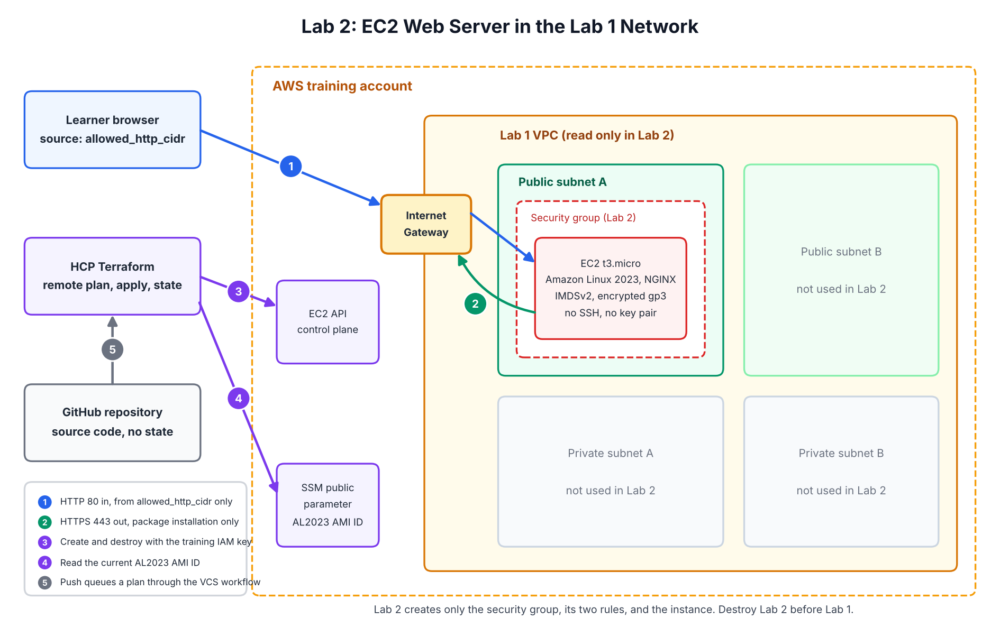

# Lab 2: EC2 Web Server

Part of the Terraform AWS Security Training series. This lab deploys one
Amazon Linux 2023 EC2 instance running NGINX into the network built by
Lab 1, using HCP Terraform for remote execution and state.

## 1. Goal

Deploy a small, hardened web server into an existing network, prove it
works, and destroy it cleanly. The success page shows who deployed it,
which deployment it belongs to, which lab created it, the Region, and the
cleanup date.

## 2. What You Will Learn

- How one lab consumes another lab's outputs through Terraform variables
- The difference between resources Terraform creates and data sources it only reads
- How layered guardrails work: variable validation, provider account
  restriction, data-source postconditions, and non-blocking check blocks
- How EC2 user data and `templatefile()` turn variables into a working server
- Why IMDSv2, encrypted EBS, standard CPU credits, and no SSH are the defaults
- Why an AMI from an SSM parameter needs `ignore_changes`, and how to replace an instance on purpose
- How to read a plan and a destroy plan before confirming either one

## 3. Architecture



Lab 2 creates four resources inside the Lab 1 VPC:

| Resource | Purpose |
|---|---|
| `aws_security_group.web` | Firewall for the instance, with no default rules |
| `aws_vpc_security_group_ingress_rule.http` | TCP 80 from `allowed_http_cidr` only |
| `aws_vpc_security_group_egress_rule.https` | TCP 443 out, for package installation |
| `aws_instance.web` | Amazon Linux 2023 `t3.micro` running NGINX |

Lab 2 does not create a VPC, subnet, route, gateway, key pair, Elastic IP,
load balancer, or IAM role. See [docs/architecture.md](docs/architecture.md).

## 4. Security Decisions

- No SSH, no key pair, and no port 22 rule
- HTTP is limited to one CIDR you supply, normally your own `/32`
- Egress is limited to HTTPS instead of the AWS default of all traffic
- IMDSv2 is required, with a hop limit of 1
- The root volume is encrypted gp3
- The provider refuses to run in any account except `expected_aws_account_id`
- The IAM training policy enforces the instance type, IMDSv2, and encryption
  independently of Terraform, and can only terminate or delete resources tagged `Purpose = Training`

Full detail and the training simplifications are in [SECURITY.md](SECURITY.md).

## 5. Cost Estimate

| Scenario | Approximate cost (us-east-1, list price) |
|---|---|
| 2-hour lab session | about $0.04 |
| Forgotten for 30 days | about $11.90 |
| Instance stopped for 30 days | about $0.64 (root volume only) |

A forgotten Lab 2 deployment alone exceeds the series $10 budget in about
26 days. Destroy it when you finish. See [COSTS.md](COSTS.md).

## 6. Prerequisites

- Lab 0 completed, including the AWS Budget
- Lab 1 applied in its own HCP Terraform workspace, with its outputs available
- An HCP Terraform organization connected to GitHub through the HCP Terraform GitHub App
- The training IAM user from Lab 0 with both training policies attached:
  the Lab 1 network policy and this lab's [examples/iam/training-policy.json](examples/iam/training-policy.json)
- Your public IPv4 address, from `curl -s https://checkip.amazonaws.com`

## 7. Repository Structure

```text
02-terraform-aws-ec2-web-lab/
|-- README.md
|-- SECURITY.md
|-- COSTS.md
|-- TROUBLESHOOTING.md
|-- CHANGELOG.md
|-- LICENSE
|-- .gitignore
|-- .terraform.lock.hcl
|-- versions.tf
|-- provider.tf
|-- variables.tf
|-- data.tf
|-- locals.tf
|-- main.tf
|-- checks.tf
|-- outputs.tf
|-- templates/
|   `-- user-data.sh.tftpl
|-- examples/
|   |-- terraform.tfvars.example
|   `-- iam/
|       `-- training-policy.json
|-- docs/
|   |-- architecture.md
|   |-- concepts.md
|   |-- deployment-guide.md
|   `-- cleanup-guide.md
`-- diagrams/
    `-- architecture.png
```

## 8. Terraform File Walkthrough

| File | What it does |
|---|---|
| `versions.tf` | Pins the Terraform and AWS provider versions shared with Lab 1. |
| `provider.tf` | Sets the Region, restricts the run to `expected_aws_account_id`, and applies the standard tags to every resource. |
| `variables.tf` | Declares every input and rejects bad values before AWS is contacted. |
| `data.tf` | Reads the Lab 1 VPC, subnet, and route table, and the latest Amazon Linux 2023 AMI ID. Postconditions stop the plan if the subnet is outside the VPC or has no route to an Internet Gateway. |
| `locals.tf` | Builds the name prefix and renders the user data template. |
| `main.tf` | Creates the security group, its two rules, and the instance. |
| `checks.tf` | Warns, without blocking, if HTTP access is wider than /24 or the expiration date has passed. |
| `outputs.tf` | Publishes the website URL and IDs used for validation. |
| `templates/user-data.sh.tftpl` | First-boot script that adds a swap file, installs NGINX, and writes the success page. |

Concepts behind these choices are explained in [docs/concepts.md](docs/concepts.md).

## 9. HCP Terraform Variables

Environment variables authenticate the provider. Mark both keys Sensitive.

| Key | Category | Value |
|---|---|---|
| `AWS_ACCESS_KEY_ID` | env | Training IAM user access key ID |
| `AWS_SECRET_ACCESS_KEY` | env | Training IAM user secret access key |
| `AWS_REGION` | env | Your lab Region, for example `us-east-1` |
| `AWS_DEFAULT_REGION` | env | Same as `AWS_REGION` |

Terraform variables describe the target environment.

| Key | Required | Example | Source |
|---|---|---|---|
| `aws_region` | Yes | `us-east-1` | Must match the Lab 1 Region |
| `expected_aws_account_id` | Yes | 12 digits | Your training account |
| `owner_name` | Yes | `Jane-Learner` | Letters, digits, spaces, `.`, `_`, `-` |
| `deployment_id` | Yes | `jane-ec2-web-01` | Up to 40 characters, no spaces |
| `expiration_date` | Yes | `2026-12-31` | Your cleanup date |
| `vpc_id` | Yes | `vpc-...` | Lab 1 output `vpc_id` |
| `public_subnet_id` | Yes | `subnet-...` | One entry of Lab 1 output `public_subnet_ids` |
| `allowed_http_cidr` | Yes | `203.0.113.10/32` | Your public IP followed by `/32` |
| `instance_type` | No | `t3.micro` | Default; the only allowed value |
| `project_name` | No | `terraform-aws-security-training` | Default |

The Add variable form in HCP Terraform defaults to Terraform variable.
Change the category for the four AWS keys. An example of the Terraform
variables is in [examples/terraform.tfvars.example](examples/terraform.tfvars.example).

## 10. IAM Permissions

[examples/iam/training-policy.json](examples/iam/training-policy.json) is a
training baseline, not a universal production policy. It allows:

- Read-only EC2 describe calls needed for plan and refresh
- `ssm:GetParameter` on the public Amazon Linux AMI parameters only
- Security group creation and rule management
- `ec2:RunInstances` only for `t3.micro`, IMDSv2 required, and encrypted volumes
- `ec2:TerminateInstances` and `ec2:DeleteSecurityGroup` only on resources tagged `Purpose = Training`
- Tagging at creation, or retagging resources already tagged `Purpose = Training`

Attach it alongside the Lab 1 policy. Do not attach `AdministratorAccess`.

## 11. Plan

Start a run in HCP Terraform and review the plan before confirming. Expect
`Plan: 4 to add, 0 to change, 0 to destroy` and no check warnings. The full
review checklist is in [docs/deployment-guide.md](docs/deployment-guide.md).

## 12. Apply

Confirm the plan only after the checklist passes. Auto Apply stays off.
The instance is ready when NGINX finishes installing, which can take up to 5 minutes after apply.

## 13. Validate

Open the `website_url` output from the network in `allowed_http_cidr`. The
success page must show your owner name, deployment ID, lab, Region, and
expiration date. Then confirm IMDSv2, encryption, CPU credit mode, rules,
and tags with the AWS CLI commands in [docs/deployment-guide.md](docs/deployment-guide.md).
Finally, start another plan and confirm it reports no changes.

## 14. Destroy

Destroy Lab 2 before Lab 1. Queue a destroy plan, confirm it lists only the
four Lab 2 resources, then confirm. Verify cleanup with the commands in
[docs/cleanup-guide.md](docs/cleanup-guide.md).

## 15. Troubleshooting

Common errors and fixes are in [TROUBLESHOOTING.md](TROUBLESHOOTING.md).

## 16. What Comes Next

Lab 3 adds secure S3 object storage. Later labs replace direct public
access to this instance with Systems Manager administration and an
Application Load Balancer.

Previous lab: [Lab 1 - Network Foundation](https://github.com/lshillingford/01-terraform-aws-network-foundation-lab)
Series overview: [Terraform AWS Security Training](https://github.com/lshillingford/00-terraform-aws-security-training)
