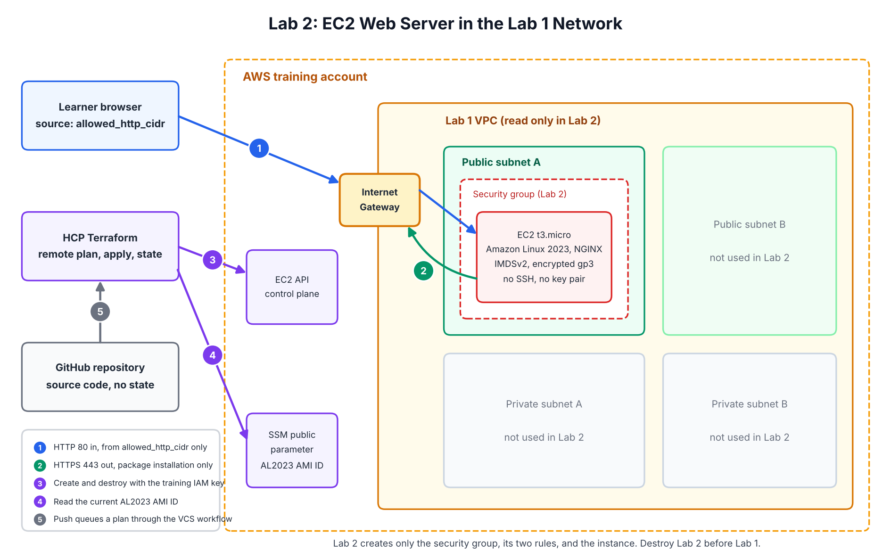

# Architecture



## What Lab 2 owns

| Resource | Owned by | Notes |
|---|---|---|
| Security group | Lab 2 | No inline rules. The provider removes the AWS default allow-all egress rule. |
| Ingress rule, TCP 80 | Lab 2 | Source is `allowed_http_cidr` only |
| Egress rule, TCP 443 | Lab 2 | Destination `0.0.0.0/0`, for package repositories |
| EC2 instance and root volume | Lab 2 | `t3.micro`, Amazon Linux 2023, encrypted gp3, 8 GiB |
| Auto-assigned public IPv4 address | AWS, released at stop or terminate | Requested by `associate_public_ip_address = true` |
| Network interface | AWS, created with the instance | Deleted when the instance terminates |

## What Lab 2 reads but does not own

| Data source | Provided by | Why it is read |
|---|---|---|
| `aws_vpc.selected` | Lab 1 | The security group must be created in this VPC |
| `aws_subnet.selected` | Lab 1 | The instance launches here; postcondition checks it is in the VPC |
| `aws_route_table.selected` | Lab 1 | Postcondition checks the subnet routes to an Internet Gateway |
| `aws_ssm_parameter.al2023` | AWS | Current Amazon Linux 2023 AMI ID for the Region |

Lab 1 output values reach Lab 2 as Terraform variables that the learner
copies into the Lab 2 workspace. The two workspaces do not share state.

## Resources AWS may add outside Terraform

If the account uses Amazon GuardDuty Runtime Monitoring with automated EC2
agent management, GuardDuty adds a `guardduty-data` VPC endpoint and a
`GuardDutyManagedSecurityGroup-<vpc-id>` security group to the Lab 1 VPC
when the instance launches. Lab 2 does not create or track them. They must
be removed before Lab 1 can be destroyed; see the
[cleanup guide](cleanup-guide.md).

## Traffic flows

| Flow | Path | Allowed by |
|---|---|---|
| Learner to website | Browser, Internet, Internet Gateway, instance port 80 | Ingress rule from `allowed_http_cidr` |
| Instance to package repositories | Instance port 443, Internet Gateway, Internet | Egress rule TCP 443 |
| Instance to DNS | VPC resolver at the VPC base address plus two | Not filtered by security groups |
| Instance to metadata service | Link-local 169.254.169.254 with an IMDSv2 token | Not filtered by security groups; hop limit 1 |
| HCP Terraform to AWS | AWS APIs over HTTPS with the training access key | IAM training policies |

Inbound SSH does not exist in this design. There is no rule for it and no key pair.

## Dependency order

```text
Create:   Lab 1 network  ->  Lab 2 security group and rules  ->  Lab 2 instance
Destroy:  Lab 2 instance ->  Lab 2 security group            ->  Lab 1 network
```

Destroying Lab 1 first fails with `DependencyViolation`, because the Lab 2
network interface and security group still use the Lab 1 subnet and VPC.

## Not included

VPC, subnets, routes, Internet Gateway, NAT Gateway, Elastic IP, key pair,
IAM role or instance profile, load balancer, DNS records, and TLS
certificates. Later labs add some of these deliberately.
